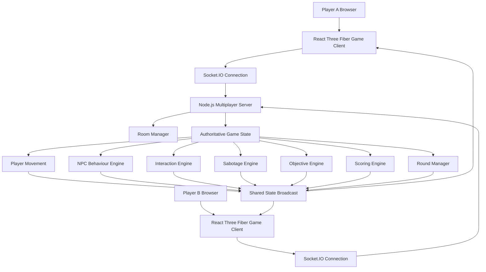

# CIVIC CLASH
## Complete Product Requirements Document (PRD)

**Tagline:** Truth is a responsibility. Deception is a strategy.

**Product Type:** 3D Asymmetric Multiplayer Civic Strategy Game  
**Platform:** Desktop Web Browser  
**Players:** Exactly 2 players per match  
**Game Perspective:** Third-Person 3D  
**Game Mode:** Real-Time Online Multiplayer  
**Initial Release:** Hackathon MVP  
**Number of Levels:** 3  
**Target Audience:** Teenagers, college students, young adults, and general audiences interested in multiplayer games and civic awareness.

---

# 1. PROJECT OVERVIEW

## 1.1 Product Vision

Civic Clash is a real-time, two-player asymmetric multiplayer game that combines social strategy, environmental interaction, deception, exploration, decision-making, and civic education.

The game revolves around two opposing roles:

1. **Objective Runner — The Responsible Citizen:** A player who attempts to resolve a civic emergency, help affected people, interact with witnesses, preserve relevant information, and ensure that appropriate authorities are informed.

2. **Saboteur — The Manipulator:** A player who attempts to prevent the Objective Runner from completing their objectives by manipulating NPCs, creating diversions, spreading misinformation, interfering with environmental mechanisms, and escaping accountability.

Both players inhabit the SAME 3D environment.

They can independently move, explore, interact with objects, approach NPCs, and influence the world.

The gameplay must be driven by player decisions rather than automatic events.

## 1.2 The Core Concept

Civic Clash is NOT:

- A conventional endless runner.
- A jumping and obstacle-avoidance game.
- An Among Us clone.
- A traditional detective game.
- A game where Player 2 simply presses buttons to spawn obstacles.
- A game consisting of predetermined cutscenes and automatic objectives.

Civic Clash IS:

- An interactive third-person 3D experience.
- A two-player strategic competition.
- A social manipulation game.
- A dynamic NPC interaction simulator.
- An environmental puzzle and decision-making experience.
- An educational game that teaches civic responsibility through gameplay.

## 1.3 Core Gameplay Philosophy

The Objective Runner should feel like an ordinary person navigating a difficult real-world situation.

The Saboteur should feel like an intelligent opponent who is actively influencing that situation.

Both players must have meaningful things to do throughout the match.

**The Runner should not automatically run. The Saboteur should not automatically sabotage. Every important action must require player input.**

---

# 2. PROBLEM STATEMENT AND SOCIAL IMPACT

Everyday emergencies can involve road accidents, public safety incidents, fire hazards, unsafe construction, and other situations where immediate assistance is necessary.

However, people sometimes hesitate to help because they fear legal complications, confrontation, or getting unnecessarily involved.

Civic Clash attempts to address this problem through interactive learning.

Instead of teaching civic responsibility through conventional educational slides, it introduces realistic scenarios in which players must:

- Recognize an emergency.
- Assess their surroundings.
- Contact appropriate emergency services.
- Request assistance.
- Communicate with witnesses.
- Recognize misinformation.
- Preserve relevant information.
- Understand basic legal protections.
- Make responsible decisions under pressure.

The game should communicate an important principle:

**Helping someone in an emergency should not be discouraged by intimidation or misinformation. Knowing your rights and responding responsibly can make a difference.**

The game is educational, not a replacement for professional emergency training or legal advice.

---

# 3. PRODUCT OBJECTIVES

## 3.1 Primary Objectives

1. Deliver a functional two-player online multiplayer game.
2. Implement two distinctly different playable roles.
3. Build an interactive third-person 3D environment.
4. Implement manually controlled player movement.
5. Introduce meaningful NPC conversations and interactions.
6. Implement real-time sabotage and counter-strategy.
7. Provide three distinct playable levels.
8. Implement role switching after each round.
9. Introduce a fair competitive scoring system.
10. Integrate civic and legal awareness into actual gameplay.

## 3.2 Success Criteria

The final game must demonstrate:

- Two players connecting from separate computers.
- Both players seeing each other's movement in real time.
- Independent controls and abilities for both roles.
- At least three interactive environmental elements in every level.
- Multiple NPCs with different behaviours.
- Functional dialogue choices.
- Sabotage and counter-sabotage mechanics.
- Resource management.
- Clearly defined win/loss conditions.
- Round restart functionality.
- Automatic role switching.
- Final scoreboard.
- Educational debrief after each level.

---

# 4. GAME DESIGN SUMMARY

| Property | Specification |
|---|---|
| Game title | Civic Clash |
| Genre | Asymmetric multiplayer strategy |
| Players | 2 |
| Perspective | Third-person 3D |
| Camera | Follow camera with mouse rotation |
| Movement | WASD |
| Interaction | E |
| Sprint | Shift |
| Inventory | I |
| Map | M |
| Multiplayer | Online |
| Networking | WebSocket / Socket.IO |
| Match duration | Approximately 8–10 minutes per round |
| Number of levels | 3 |
| Roles | Objective Runner and Saboteur |
| Role switching | After every round |
| Scoring | Role-specific score and combined score |
| Environment | Interactive 3D urban environments |

## 4.1 Gameplay Loop

The complete gameplay loop:

1. Players open the game.
2. Both players enter a multiplayer lobby.
3. One player creates a room.
4. The second player joins using a room code.
5. Both players select Ready.
6. The game assigns initial roles.
7. The selected level loads.
8. Both players spawn at different locations.
9. The incident scenario begins.
10. Players manually explore the environment.
11. Players interact with NPCs and environmental objects.
12. The Objective Runner attempts to complete civic objectives.
13. The Saboteur attempts to disrupt those objectives.
14. The match ends when the timer expires or a decisive win condition is reached.
15. Both players receive individual performance scores.
16. Roles switch.
17. The second round begins.
18. The combined level result is displayed.
19. The next level becomes available.
20. After all three levels, a final winner is declared.

The game must never automatically complete a player's objectives merely because a timer or cutscene has advanced.

---

# 5. PLAYER ROLES

# 5.1 PLAYER 1 — OBJECTIVE RUNNER

## Role Identity

The Objective Runner is an ordinary responsible citizen who witnesses an incident.

They are not a police officer, professional detective, or emergency medical professional.

Their responsibility is to respond safely, seek assistance, communicate effectively, and ensure that relevant information reaches the appropriate people.

## Primary Mission

Resolve the incident by completing the assigned civic objectives while countering the Saboteur's manipulation.

## Runner Responsibilities

### A. Assess the situation

- Reach the incident location.
- Examine the surroundings.
- Identify immediate environmental dangers.
- Approach the injured person when safe.
- Inspect available information.
- Identify people who might have witnessed the incident.

### B. Provide appropriate assistance

- Contact emergency services.
- Request an ambulance.
- Ask available bystanders for help.
- Use the first-aid interaction system.
- Follow on-screen safety guidance.
- Ensure the victim receives appropriate assistance.

### C. Communicate with NPCs

- Talk to witnesses.
- Ask questions.
- Select dialogue responses.
- Convince hesitant people to cooperate.
- Identify inconsistent statements.
- Request relevant information.

### D. Preserve information

- Request CCTV footage.
- Record witness observations.
- Note relevant vehicle information.
- Preserve available records.
- Avoid altering or tampering with evidence.

### E. Make responsible decisions

- Recognize intimidation.
- Correct misinformation.
- Understand Good Samaritan protections.
- Avoid unsafe or aggressive actions.
- Prioritize the victim's safety over identifying the culprit.

## Runner Controls

| Key | Action |
|---|---|
| W | Move forward |
| A | Move left |
| S | Move backward |
| D | Move right |
| Mouse | Rotate camera |
| Shift | Sprint |
| E | Interact |
| I | Open inventory |
| M | Open map |
| Esc | Pause/settings |
| Space | Optional contextual action, if required |

Movement must be continuous and manually controlled.

Do not implement automatic running toward objectives.

## Runner Abilities

### 1. Inspect

Allows the player to examine an object, person, or location.

Examples:
- Inspect the victim.
- Inspect a damaged vehicle.
- Inspect a CCTV monitor.
- Inspect a suspicious object.

### 2. Communicate

Allows the player to start an NPC conversation.

Dialogue options should be contextual and dependent on the NPC's knowledge.

### 3. Request Assistance

Allows the player to request help from available bystanders.

Different NPCs can have different capabilities.

### 4. Emergency Contact

Allows the player to initiate an emergency call.

For the Indian setting, include 112 as the emergency response number.

The call should have an interactive interface:

- Select emergency category.
- Confirm incident location.
- Select the information to communicate.
- Confirm the emergency request.

The interaction should not require real external calls or actual emergency-service integration.

### 5. Basic First Aid

Introduce a guided, educational first-aid interaction.

Examples:
- Ensure the surrounding area is safe.
- Check responsiveness using an appropriate guided prompt.
- Request professional medical help.
- Follow the game's approved first-aid instructions.
- Avoid unnecessary movement of an injured person.

Do not teach advanced medical procedures or dangerous treatment.

## Runner Resources

| Resource | Purpose |
|---|---|
| Time | Limits the duration of the round |
| First-aid supplies | Supports guided first-aid interactions |
| Witness cooperation | Determines access to NPC assistance |
| Information | Represents gathered reliable incident information |
| Trust | Measures NPC willingness to cooperate |

---

# 5.2 PLAYER 2 — SABOTEUR

## Role Identity

The Saboteur is responsible for the incident and wants to avoid accountability.

They know more about the incident than the Runner.

Their job is to strategically manipulate the situation and prevent the Runner from achieving all their objectives.

The Saboteur is a fully playable character, not an invisible game administrator.

## Primary Mission

Avoid identification and prevent the Runner from completing enough objectives to obtain a perfect result.

## Saboteur Responsibilities

### A. Manipulate witnesses

- Approach witnesses.
- Start conversations.
- Provide misleading information.
- Create doubt.
- Convince NPCs not to cooperate.
- Encourage witnesses to leave the area.

### B. Create distractions

- Activate a permitted environmental distraction.
- Cause a temporary diversion.
- Redirect an NPC's attention.
- Encourage confusion in a nearby area.

### C. Manipulate the environment

- Temporarily disable selected CCTV equipment.
- Temporarily block certain non-essential pathways.
- Operate selected environmental mechanisms.
- Create alternate distractions.
- Conceal or relocate designated game objects.

### D. Mislead the Runner

- Provide false information.
- Send the Runner toward an irrelevant location.
- Create false leads.
- Contradict genuine witness statements.

### E. Escape accountability

- Reach a designated escape location.
- Avoid being identified by reliable witnesses.
- Manage suspicion.
- Prevent sufficient information from being assembled against them.

## Saboteur Controls

Use the same movement controls as the Runner.

The Saboteur must also manually walk, explore, interact, and approach NPCs.

## Saboteur Abilities

The Saboteur has a limited sabotage-energy resource.

Initial resource: 100 energy per round.

| Ability | Energy Cost | Effect |
|---|---:|---|
| Mislead witness | 15 | Temporarily changes an NPC's belief |
| Create distraction | 20 | Redirects nearby NPC attention |
| Temporary route obstruction | 25 | Blocks a designated shortcut |
| Disable CCTV | 30 | Temporarily disables a selected camera |
| Create false lead | 20 | Creates a misleading information clue |

All abilities must:

- Have cooldowns.
- Consume energy.
- Have visible or discoverable effects.
- Be validated by the server.
- Be limited to designated targets.
- Never permanently disable critical objectives.

## Saboteur Limitations

1. Cannot permanently disable emergency communication.
2. Cannot directly injure the victim.
3. Cannot prevent the Runner from accessing all alternative routes.
4. Cannot manipulate the same NPC continuously.
5. Cannot use unlimited sabotage abilities.
6. Cannot automatically teleport.
7. Cannot instantly escape.
8. Cannot modify authoritative game scores.
9. Cannot delete real player data or modify the server state directly.

---

# 6. UNIQUE GAMEPLAY MECHANICS

These mechanics define the identity of Civic Clash.

# 6.1 Dynamic NPC Social Interaction

NPCs are the central gameplay component.

They must not behave like static information kiosks.

Every important NPC should have:

- Unique name.
- Character model.
- Personality.
- Current location.
- Movement behaviour.
- Knowledge of the incident.
- Trust score.
- Fear score.
- Cooperation score.
- Belief about the incident.
- Dialogue options.
- Interaction history.

## NPC State Model

Each NPC maintains:

```javascript
{
  id: "shopkeeper_01",
  name: "Ramesh",
  role: "Shopkeeper",

  position: {
    x: 0,
    y: 0,
    z: 0
  },

  trust: 60,
  fear: 20,
  cooperation: 40,

  knowledge: [
    "Saw the black vehicle",
    "Has CCTV footage"
  ],

  belief: "The incident was an accident",

  manipulated: false,
  cooperationStatus: "hesitant",

  interactedWithRunner: false,
  interactedWithSaboteur: false
}
```

Values are illustrative initial values.

## NPC Trust and Fear

Trust, fear, and cooperation must be separate variables.

### Trust

Measures how much the NPC believes the current player's statements.

### Fear

Measures how intimidated or uncomfortable the NPC feels.

### Cooperation

Measures willingness to assist.

These variables should influence dialogue and NPC decisions.

For example:

- High trust + low fear = willing to cooperate.
- Low trust + high fear = likely to avoid conversation.
- High trust in the Runner = willing to provide information.
- High trust in the Saboteur = more susceptible to misinformation.

NPCs must not permanently switch loyalty after one interaction.

## NPC Interaction Example

Initial state:

Shopkeeper has seen the accident and has CCTV footage.

Runner approaches:

"Sir, did you see what happened?"

Shopkeeper:

"I saw a car hit someone, but I don't want to get involved."

Runner dialogue choices:

1. "Could you please preserve the footage? It may help establish what happened."
2. "I understand your concern. I will contact the appropriate authorities."
3. "Give me the footage immediately."

Different responses should produce different trust outcomes.

Saboteur approaches:

"Why are you getting involved? You don't need unnecessary trouble."

Saboteur dialogue choices:

1. Encourage the shopkeeper to stay away.
2. Spread doubt about the Runner.
3. Suggest that the footage is irrelevant.

The Runner can subsequently return and use reliable information to challenge the misinformation.

## NPC Intelligence Requirement

NPC behaviour must be deterministic and state-driven.

Do not require an external LLM API for core gameplay.

Use predefined dialogue trees, state transitions, and interaction rules so the game works reliably without internet-dependent AI services.

Optional future feature: AI-generated NPC conversations.

---

# 6.2 TRUST VS SUSPICION SYSTEM

Two important global gameplay variables must exist.

### Runner: Community Cooperation

Represents the overall level of cooperation received from NPCs.

### Saboteur: Exposure/Suspicion

Represents the likelihood that the Saboteur's actions will expose their identity.

Suggested initial display:

| Variable | Initial value |
|---|---:|
| Community cooperation | 30/100 |
| Saboteur suspicion | 0/100 |

Both variables should update based on player actions.

Examples:

| Action | Effect |
|---|---|
| Runner communicates respectfully | NPC trust increases |
| Runner makes unsupported accusations | NPC trust decreases |
| Saboteur successfully misleads NPC | NPC belief changes |
| Saboteur behaves suspiciously | Suspicion increases |
| Runner establishes a contradiction | Suspicion increases |
| Witness provides reliable information | Relevant information progress increases |

Suspicion must not automatically reveal the Saboteur at a particular arbitrary value.

Instead, identification should require sufficient reliable information and a valid reporting action.

---

# 6.3 INFORMATION VERIFICATION

The Runner should not receive points simply for collecting random objects.

Information must have different reliability levels.

Example:

| Information | Reliability |
|---|---|
| Random rumour | Low |
| Eyewitness account | Medium |
| Consistent statements from multiple witnesses | High |
| Authentic CCTV recording | High |

The Runner must compare information and identify contradictions.

The Saboteur can introduce false leads, but the Runner should be able to challenge them through reliable information.

This creates strategic deduction without turning the game into another conventional detective game.

---

# 6.4 INTERACTIVE OBJECT SYSTEM

All important objects must support interaction.

When a player approaches an interactable object:

1. Detect proximity.
2. Display an interaction prompt.
3. Press E to interact.
4. Open the contextual interaction UI.
5. Perform the selected action.
6. Update the shared game state.
7. Display the result to both players where appropriate.

Example prompt:

`[E] Interact with CCTV console`

The object interaction system must support:

- Phones.
- CCTV consoles.
- Emergency equipment.
- Traffic signals.
- Shop shutters.
- Doors.
- First-aid kits.
- Notice boards.
- Documents.
- Escape gates.
- Environmental controls.

Use a reusable interaction interface rather than hardcoding every object separately.

---

# 6.5 RESOURCE MANAGEMENT

The Runner and Saboteur have different resources.

## Runner Resources

- Time.
- First-aid supplies.
- Available witness assistance.
- Information collected.

## Saboteur Resources

- Sabotage energy.
- Available manipulation opportunities.
- Remaining escape opportunities.
- Suspicion level.

Resources should affect strategic decisions.

A player should have to decide whether to spend resources now or save them for later.

---

# 6.6 DYNAMIC ENVIRONMENT

The world should respond to player actions.

Examples:

- NPCs walk away after a conversation.
- Shop shutters open and close.
- CCTV displays change.
- Traffic signals change.
- Environmental distractions attract NPCs.
- Doors open or close.
- Players take different routes.
- NPCs gather around an emergency.
- The emergency phone interface updates after a successful call.

All critical changes must be synchronized across both clients.

---

# 7. LEVEL DESIGN

Three distinct levels must be developed.

Each level must have:

- A different environment.
- A different civic incident.
- A different objective sequence.
- At least three interactive environmental elements.
- At least four meaningful NPCs.
- Multiple movement routes.
- Sabotage opportunities.
- An escape mechanism for the Saboteur.
- A unique educational debrief.

The levels must reuse common gameplay systems while maintaining different visual identities and objectives.

---

# LEVEL 1: HIT AND RUN — THE FIRST RESPONSE

## Scenario

Location: Busy Indian urban intersection.

Time: Evening.

A speeding black car hits a pedestrian and escapes.

The injured pedestrian is on the road.

Several witnesses are present.

The driver is the Saboteur.

The Runner is an ordinary citizen who witnesses the accident.

## Environment

Create a realistic Indian city street with:

- Road intersections.
- Pedestrian crossings.
- Streetlights.
- Shops.
- Bus stop.
- Traffic signal.
- Parked vehicles.
- Roadside stalls.
- Sidewalks.
- CCTV cameras.
- Accident location.
- Emergency interaction points.

## NPCs

### NPC 1: Injured Victim

State:

- Injured.
- Requires assistance.
- Cannot independently move to safety.

Runner interactions:

- Assess immediate safety.
- Initiate emergency assistance.
- Perform guided first-aid actions.

Saboteur interactions:

- Cannot directly injure or manipulate the victim.

### NPC 2: Shopkeeper

Knowledge:

- Saw the accident.
- Has CCTV footage.

Runner:

- Request preservation of footage.
- Obtain relevant information.

Saboteur:

- Discourage sharing.
- Create doubt about the importance of footage.

### NPC 3: Eyewitness

Knowledge:

- Saw the vehicle.
- Remembers some identifying details.

Runner:

- Ask questions.
- Obtain a description.

Saboteur:

- Manipulate their recollection through misinformation.

### NPC 4: Bystander

Knowledge:

- Saw the victim fall.
- Can potentially assist.

Runner:

- Request help.
- Assign a simple assistance task.

Saboteur:

- Distract or discourage them.

### NPC 5: Traffic Officer

Knowledge:

- Can assist with reporting and traffic safety.

Runner:

- Report the incident.
- Provide reliable information.

Saboteur:

- Attempt to delay or mislead the Runner without overriding the officer's authoritative decisions.

## Runner Objectives

1. Reach the incident location.
2. Assess the surroundings.
3. Initiate emergency assistance.
4. Obtain assistance from at least one bystander.
5. Talk to the eyewitness.
6. Preserve the CCTV information.
7. Report reliable information.

## Saboteur Objectives

1. Approach the eyewitness.
2. Attempt to manipulate the shopkeeper.
3. Create one environmental distraction.
4. Delay the Runner.
5. Reach the escape location without being identified.

## Interactive Environmental Elements

### Element 1: Emergency Phone

Runner:

- Contact emergency services.
- Select the incident category.
- Confirm location.
- Complete the call interaction.

Saboteur:

- Cannot permanently disable it.
- May temporarily create a distraction near the phone.

### Element 2: CCTV Console

Runner:

- Request footage preservation.
- Review available recording.
- Identify useful information.

Saboteur:

- Temporarily disable the camera.
- Must physically approach the console.
- Cannot permanently delete the only available evidence.

### Element 3: Traffic Signal

Runner:

- Use the pedestrian crossing.
- Activate an available pedestrian crossing request.

Saboteur:

- Trigger a temporary diversion.
- Create a route delay.

### Additional Elements

- First-aid kit.
- Shop shutter.
- Vehicle inspection.
- Roadside map.
- Alternative street route.

## Educational Learning

- Good Samaritan protections.
- Emergency number 112.
- Basic accident-scene safety.
- Appropriate first response.
- Importance of witness information.

---

# LEVEL 2: PUBLIC SAFETY — THE MARKETPLACE INCIDENT

## Scenario

Location: Crowded Indian marketplace.

A fire starts because of unsafe electrical equipment in a shop.

People are panicking.

The person responsible for maintaining the equipment is the Saboteur.

The Runner must coordinate an appropriate emergency response and protect people.

## Environment

Create:

- Small shops.
- Market stalls.
- Pedestrian pathways.
- Electrical distribution area.
- Fire alarm.
- Emergency exit.
- Storage area.
- Security office.
- Fire extinguishers.
- Public gathering area.

## NPCs

1. Shopkeeper: Knows about the electrical equipment.
2. Worker: Knows where the fire started.
3. Customer: Is confused and needs assistance.
4. Security Guard: Knows the emergency exits.
5. Market Association Representative: Has relevant safety information.

## Runner Objectives

1. Identify the immediate danger.
2. Activate the emergency alarm.
3. Contact emergency services.
4. Guide people towards a safe exit.
5. Obtain relevant information from the worker.
6. Identify the unsafe equipment.
7. Report the incident.

## Saboteur Objectives

1. Prevent the Runner from quickly understanding the situation.
2. Mislead the shopkeeper.
3. Create a temporary distraction.
4. Attempt to close a designated non-essential passage.
5. Escape before being identified.

## Interactive Environmental Elements

### Element 1: Fire Alarm

Runner:

- Activate alarm.
- Trigger evacuation instructions.

Saboteur:

- Temporarily interfere with a designated secondary alarm mechanism.

The primary emergency alarm must always remain accessible through an alternative.

### Element 2: Electrical Control Panel

Runner:

- Inspect the source of danger.
- Follow safe, guided instructions to report or isolate the hazard.

Saboteur:

- Temporarily interfere with access to a designated information panel.

Do not implement dangerous real-world electrical repair instructions.

### Element 3: Emergency Exit Shutters

Runner:

- Open designated safe evacuation routes.
- Guide NPCs.

Saboteur:

- Temporarily close a non-essential route.
- Must leave at least one safe route accessible.

### Additional Elements

- Fire extinguisher interaction.
- Emergency exit map.
- Security office.
- Shop documents.
- Public announcement system.

## Educational Learning

- Fire safety.
- Emergency evacuation.
- Public safety responsibility.
- Importance of reporting hazards.
- Avoiding panic and misinformation.

---

# LEVEL 3: THE COVER-UP — CONSTRUCTION SITE ACCIDENT

## Scenario

Location: Urban construction site.

A worker is injured because of an unsafe construction-site condition.

The contractor responsible for the unsafe condition is the Saboteur.

The Runner must arrange assistance and ensure that relevant information is preserved and reported.

## Environment

Create:

- Construction site.
- Scaffolding.
- Safety barriers.
- Construction office.
- Equipment storage.
- Security cabin.
- CCTV.
- Site entrance.
- Public road.
- Medical assistance area.

## NPCs

1. Injured Worker: Requires medical assistance.
2. Site Supervisor: Knows about site conditions.
3. Contractor: The Saboteur.
4. Security Guard: Has access information.
5. Nearby Resident: Witnessed the incident.

## Runner Objectives

1. Assess the safety of the surroundings.
2. Initiate emergency assistance.
3. Request appropriate help for the worker.
4. Talk to the supervisor.
5. Preserve relevant records.
6. Obtain witness information.
7. Report the incident through the appropriate channel.

## Saboteur Objectives

1. Discourage the supervisor from cooperating.
2. Create a false explanation.
3. Attempt to conceal designated records.
4. Mislead the nearby resident.
5. Reach the escape point.

## Interactive Environmental Elements

### Element 1: Construction Safety Control

Runner:

- Inspect safety information.
- Identify missing or damaged safety measures.
- Record relevant information.

Saboteur:

- Temporarily obstruct access to designated records.

### Element 2: Contractor Document Office

Runner:

- Request relevant documents.
- Preserve available information.

Saboteur:

- Attempt to withhold designated documents.
- Create an alternative explanation.

### Element 3: Security Camera System

Runner:

- Request available recording information.

Saboteur:

- Temporarily disable a selected camera.
- Must manage the resulting suspicion.

### Additional Elements

- Safety barricades.
- Site entrance.
- Worker equipment.
- Site register.
- Security cabin.
- Alternate access route.

## Educational Learning

- Workplace safety.
- Reporting unsafe conditions.
- Preserving relevant information.
- Responsible public conduct.
- Accountability and civic awareness.

---

# 8. MULTIPLAYER SYSTEM

## 8.1 Online Multiplayer Requirement

The game must support two separate players connecting from different computers through a room code.

Use real-time WebSocket communication.

Recommended implementation:

- Socket.IO.
- Node.js server.
- Authoritative server game state.
- Client-side rendering.
- Server-validated actions.

## 8.2 Lobby System

The home screen must provide:

- Create Room.
- Join Room.
- Enter Room Code.
- Player Name.
- Ready Status.
- Connection Status.
- Start Game.

### Create Room Flow

1. Player A selects Create Room.
2. Server generates a unique room code.
3. Player A enters the lobby.
4. Room code is displayed.
5. Player B enters the code.
6. Player B joins the same room.
7. Both players select Ready.
8. Host starts the match.

### Lobby Restrictions

- Maximum two players.
- Third player cannot join an active room.
- Prevent duplicate player identities within a room.
- Display waiting status if only one player has joined.
- Handle disconnections.
- Allow room recreation.

## 8.3 Multiplayer Synchronization

The server must maintain authoritative state for:

- Player positions.
- Player rotation.
- Player roles.
- NPC positions.
- NPC states.
- NPC trust and fear.
- Dialogue actions.
- Environmental interactions.
- Sabotage actions.
- Resource consumption.
- Objectives.
- Timer.
- Score.
- Round transitions.

### Synchronization Requirements

Both clients must see:

- The other player's movement.
- The other player's position.
- NPC movement.
- Shared object state changes.
- Dialogue consequences.
- Environmental changes.
- Objective progress.
- Score changes.

The local player should have responsive movement.

Use client-side prediction for local movement where practical, with server reconciliation.

The server must validate important gameplay actions.

Do not trust client-submitted scores or sabotage resource values.

## 8.4 Disconnect Handling

If a player disconnects:

1. Show a connection-lost notification.
2. Pause or freeze the match for a short grace period.
3. Allow reconnection using the same room/session.
4. If reconnection fails, declare the match abandoned.
5. Provide an option to restart.

Do not silently substitute a bot in the initial MVP.

---

# 9. ROUND MANAGEMENT AND ROLE SWITCHING

Every level contains two rounds.

Round 1:

- Player A = Objective Runner.
- Player B = Saboteur.

Round 2:

- Player A = Saboteur.
- Player B = Objective Runner.

Each round should have approximately 4–5 minutes of active gameplay, adjustable during testing.

After the first round:

1. Freeze gameplay.
2. Display the round summary.
3. Calculate the role-specific scores.
4. Display the role-switch notification.
5. Swap roles.
6. Reset round-specific resources.
7. Load the second round.
8. Start the match timer.

After the second round:

1. Calculate combined scores.
2. Display the level winner.
3. Show educational information.
4. Provide Continue and Replay options.

Repeat for all three levels.

---

# 10. SCORING SYSTEM

The scoring system must reward good decisions and strategic gameplay.

It should not reward reckless actions or unlimited sabotage.

## 10.1 Runner Scoring

| Action | Points |
|---|---:|
| Assess the incident safely | +50 |
| Successfully initiate emergency response | +100 |
| Victim receives appropriate assistance | +150 |
| Obtain a cooperative witness | +50 |
| Preserve reliable CCTV information | +100 |
| Identify a contradictory statement | +50 |
| Complete reporting objective | +100 |
| Complete all primary objectives | +150 bonus |

Penalties:

| Action | Points |
|---|---:|
| Unsafe interaction | -50 |
| Unsupported accusation | -25 |
| Waste a limited resource | -20 |
| Ignore an immediate safety warning | -50 |

## 10.2 Saboteur Scoring

| Action | Points |
|---|---:|
| Successfully mislead an NPC | +50 |
| Successfully create a distraction | +50 |
| Delay an optional objective | +50 |
| Create a successful false lead | +75 |
| Escape without identification | +150 |
| Maintain deception until the end | +100 |

Penalties:

| Action | Points |
|---|---:|
| Manipulation exposed | -50 |
| Suspicion reaches maximum | -100 |
| Failed sabotage attempt | -15 |
| Identified through reliable information | -150 |

All scoring must be server-controlled.

## 10.3 Final Scoring

Each player's score across all rounds must be accumulated.

The combined score determines the overall match winner.

Both players should receive equal opportunities because they each play both roles.

The game must show separate score breakdowns for:

- Runner performance.
- Saboteur performance.
- Civic decision quality.
- Strategic performance.
- Time efficiency.

## 10.4 Tie Conditions

If the final scores are equal:

1. Compare successful Runner objectives.
2. Compare civic decision quality.
3. Compare successful Saboteur objectives.
4. If still equal, declare a draw.

---

# 11. WIN AND LOSS CONDITIONS

The game must not have a simplistic binary outcome.

## Runner Success

The Runner succeeds by:

- Getting appropriate help to the victim.
- Completing critical emergency objectives.
- Obtaining sufficient reliable information.
- Successfully reporting relevant information.

The Runner does not have to personally catch or arrest the Saboteur.

## Saboteur Success

The Saboteur succeeds by:

- Avoiding identification.
- Successfully misleading NPCs.
- Delaying selected objectives.
- Reaching the designated escape location.
- Preventing the Runner from achieving a perfect result.

## Critical Educational Rule

The Saboteur must NEVER receive a higher score simply because the victim fails to receive medical assistance.

Victim safety must be prioritized over escape and evidence objectives.

The Runner should receive major rewards for successful emergency response, regardless of whether the Saboteur escapes.

---

# 12. USER INTERFACE AND USER EXPERIENCE

The game should have a professional, modern, cinematic interface.

Avoid generic browser-game styling.

## 12.1 Main Menu

Include:

- Civic Clash logo.
- Animated background showing an urban environment.
- Play Online.
- How to Play.
- Civic Learning.
- Settings.
- About.

## 12.2 Lobby UI

Display:

- Room code.
- Player A.
- Player B.
- Connection status.
- Ready status.
- Selected level.
- Start button.
- Copy room code.
- Leave room.

## 12.3 In-Game HUD

### Runner HUD

Top-left:

- Current objectives.
- Objective completion.

Top-centre:

- Match timer.

Top-right:

- Mini-map.
- Relevant NPC locations.

Bottom-left:

- Inventory.
- First-aid supplies.

Bottom-centre:

- Interaction prompt.
- Dialogue options.

Bottom-right:

- Community cooperation.
- Information progress.
- Emergency response status.

### Saboteur HUD

Top-left:

- Sabotage objectives.

Top-centre:

- Match timer.

Top-right:

- Mini-map.
- Known NPC positions.

Bottom-left:

- Sabotage abilities.
- Ability cooldowns.

Bottom-centre:

- Interaction prompt.
- Dialogue options.

Bottom-right:

- Sabotage energy.
- Suspicion level.
- Escape progress.

## 12.4 Interaction UI

Every interactable object must display a contextual prompt.

Examples:

`[E] Talk to Shopkeeper`

`[E] Inspect Victim`

`[E] Access CCTV`

`[E] Use Emergency Phone`

`[E] Request Assistance`

`[E] Open Security Office`

## 12.5 Dialogue UI

The dialogue interface should:

- Display the NPC name.
- Display the NPC's current dialogue.
- Present 2–4 possible responses.
- Display conversation history.
- Show subtle trust/cooperation feedback.
- Close using Escape.

Do not expose hidden NPC information or the opponent's private objectives.

## 12.6 Pause Menu

Include:

- Resume.
- Controls.
- Audio Settings.
- Graphics Settings.
- Restart Round (host-confirmed).
- Leave Match.

A restart must be synchronized for both players.

---

# 13. VISUAL DESIGN AND ART DIRECTION

## 13.1 Overall Visual Style

Use semi-realistic, stylized 3D graphics.

Target:

- Cinematic lighting.
- Recognizable Indian urban environments.
- Detailed but optimized environment assets.
- Expressive NPC animations.
- Smooth player movement.
- Professional HUD.
- Clear visual distinction between interactive and non-interactive objects.

Avoid overly cartoonish visuals unless required for performance.

## 13.2 Camera

Use third-person follow camera.

Requirements:

- Camera follows the local player.
- Mouse controls camera rotation.
- Smooth camera interpolation.
- Camera collision handling.
- Avoid camera clipping through buildings.
- Support different character orientations.

## 13.3 Character Design

Create distinct characters for:

- Runner.
- Saboteur.
- Shopkeeper.
- Eyewitness.
- Bystander.
- Security guard.
- Emergency personnel.
- Worker.
- Supervisor.

Use available licensed or open 3D assets.

Do not spend excessive development time creating original character models if suitable assets are available.

## 13.4 Animation

At minimum:

- Idle.
- Walk.
- Run.
- Turn.
- Interact.
- Talk.
- Inspect.
- Emergency assistance interaction.

NPCs should have idle and walking animations.

Animations must not block the player's movement unnecessarily.

---

# 14. TECHNICAL ARCHITECTURE

## 14.1 Recommended Technology Stack

### Frontend

- React.
- TypeScript.
- Vite.
- Three.js.
- React Three Fiber.
- @react-three/drei.
- Zustand for client-side state.
- Tailwind CSS for UI.

### Backend

- Node.js.
- TypeScript.
- Express.
- Socket.IO.

### Game Logic

- Server-authoritative game state.
- Event-driven interaction system.
- Finite-state machines for NPCs.
- Reusable objective system.
- Reusable sabotage system.
- Server-side scoring.

### Assets

- Blender.
- GLTF/GLB models.
- Mixamo-compatible animations.
- Licensed 3D asset libraries.

### Deployment

Frontend: Vercel or another static hosting provider.

Backend: A persistent Node.js hosting provider that supports WebSockets.

Do not assume that serverless functions support persistent Socket.IO connections.

## 14.2 Architecture Diagram



## 14.3 Project Structure

Use a clean modular structure similar to:

```text
civic-clash/
│
├── client/
│   ├── src/
│   │   ├── components/
│   │   │   ├── menu/
│   │   │   ├── lobby/
│   │   │   ├── hud/
│   │   │   ├── dialogue/
│   │   │   ├── scoreboard/
│   │   │   └── common/
│   │   │
│   │   ├── game/
│   │   │   ├── engine/
│   │   │   ├── camera/
│   │   │   ├── controls/
│   │   │   ├── characters/
│   │   │   ├── npcs/
│   │   │   ├── interactions/
│   │   │   ├── environments/
│   │   │   ├── levels/
│   │   │   └── effects/
│   │   │
│   │   ├── store/
│   │   ├── hooks/
│   │   ├── socket/
│   │   ├── assets/
│   │   ├── utils/
│   │   └── App.tsx
│   │
│   └── package.json
│
├── server/
│   ├── src/
│   │   ├── rooms/
│   │   ├── players/
│   │   ├── game/
│   │   ├── npc/
│   │   ├── interactions/
│   │   ├── sabotage/
│   │   ├── objectives/
│   │   ├── scoring/
│   │   ├── levels/
│   │   ├── socket/
│   │   └── index.ts
│   │
│   └── package.json
│
├── shared/
│   ├── types/
│   ├── constants/
│   ├── events/
│   └── schemas/
│
├── public/
│   ├── models/
│   ├── textures/
│   ├── audio/
│   └── icons/
│
├── docs/
│   ├── GAMEPLAY.md
│   ├── NETWORKING.md
│   └── CIVIC_CONTENT.md
│
├── package.json
└── README.md
```

The structure may be adjusted, but frontend, backend, shared types, and game logic must remain logically separated.

---

# 15. CORE GAME SYSTEMS — IMPLEMENTATION REQUIREMENTS

## 15.1 Player Movement

Implement:

- WASD movement.
- Mouse camera.
- Sprint.
- Collision detection.
- Ground detection.
- Smooth character rotation.
- Walk and run animations.
- Network synchronization.

Requirements:

- Character must not pass through buildings or walls.
- Character must remain within the playable arena.
- Movement must feel responsive.
- Remote player movement must interpolate smoothly.
- Movement speed must be identical for both roles unless explicitly balanced.

## 15.2 Interaction Manager

Implement a reusable interface:

```typescript
interface Interactable {
  id: string;
  name: string;
  position: Vector3;
  interactionRadius: number;

  canInteract(playerId: string): boolean;

  interact(
    playerId: string,
    action: string
  ): InteractionResult;
}
```

Every interaction must be validated.

The server should verify:

- Player exists.
- Player is in the correct room.
- Player is close enough.
- Player has permission.
- Object is available.
- Action is valid.
- Required resources are available.

## 15.3 NPC State Machine

Use a finite-state machine.

Possible NPC states:

```text
IDLE
  |
  v
OBSERVING_INCIDENT
  |
  v
APPROACHED_BY_PLAYER
  |
  v
IN_CONVERSATION
  |
  v
DECISION_PENDING
  |
  +----> COOPERATIVE
  |
  +----> HESITANT
  |
  +----> MISINFORMED
  |
  +----> LEAVING
```

NPC transitions should depend on:

- Trust.
- Fear.
- Knowledge.
- Dialogue decisions.
- Previous interactions.
- Environmental events.

Do not implement random state changes that make NPC behaviour unpredictable or unfair.

## 15.4 Objective Engine

Each objective should have:

```typescript
interface Objective {
  id: string;
  title: string;
  description: string;
  role: "RUNNER" | "SABOTEUR";

  status:
    | "LOCKED"
    | "AVAILABLE"
    | "IN_PROGRESS"
    | "COMPLETED"
    | "FAILED";

  points: number;
  dependencies: string[];
}
```

Objectives should be data-driven.

The level configuration must define objectives instead of hardcoding every objective into the UI.

## 15.5 Sabotage Engine

Every sabotage action must include:

- Ability ID.
- Energy cost.
- Cooldown.
- Maximum duration.
- Valid target types.
- Range.
- Effect.
- Countermeasure.
- Server-side validation.

Example:

```typescript
interface SabotageAbility {
  id: string;
  name: string;
  energyCost: number;
  cooldown: number;
  duration: number;
  range: number;
  targetType: string;
}
```

## 15.6 Scoring Engine

All scoring must happen on the server.

Each scoring event should contain:

- Player ID.
- Role.
- Action ID.
- Points.
- Timestamp.
- Related objective.
- Validation result.

Prevent duplicate score awards.

## 15.7 Timer

The server controls the timer.

Both clients receive the same remaining time.

Do not use independently running client timers as the authoritative source.

## 15.8 Round Manager

Possible round states:

```text
WAITING_FOR_PLAYERS
LOBBY
READY_CHECK
COUNTDOWN
ACTIVE
ROUND_ENDING
ROUND_RESULTS
ROLE_SWITCH
LEVEL_RESULTS
NEXT_LEVEL
MATCH_COMPLETE
ABANDONED
```

Implement transitions explicitly.

---

# 16. GAME BALANCING

The game must remain competitive.

The Runner should not have an impossible task.

The Saboteur should not be able to block every objective.

## Balancing Requirements

1. Every critical objective must have an alternative route or method.
2. Emergency response cannot be permanently disabled.
3. Sabotage energy must be limited.
4. Sabotage abilities must have cooldowns.
5. NPC manipulation must have diminishing returns.
6. NPCs must have maximum fear and trust values.
7. Saboteur movement speed must not exceed Runner movement speed.
8. Saboteur escape points must require a valid interaction.
9. Identification must require sufficient reliable information.
10. The Runner must receive meaningful points for saving the victim even if the Saboteur escapes.

## Suggested Match Settings

| Parameter | Initial Value |
|---|---:|
| Players | 2 |
| Active round duration | 4–5 minutes |
| Sabotage energy | 100 |
| Player walking speed | 4 units/sec |
| Player sprint speed | 6 units/sec |
| Interaction radius | 2.5 units |
| NPC conversation radius | 3 units |
| NPC trust range | 0–100 |
| NPC fear range | 0–100 |
| Saboteur suspicion range | 0–100 |

These are initial tunable values. Playtesting must determine final values.

---

# 17. CIVIC EDUCATION SYSTEM

Education must be integrated into gameplay.

Do not interrupt the experience with long paragraphs.

Use:

- Contextual hints.
- Dialogue.
- Environmental signs.
- Small information cards.
- Post-level learning summaries.
- Short quizzes.

## 17.1 Legal Awareness: Good Samaritan Protections

Level 1 should introduce the Good Samaritan framework in India.

Include:

- Motor Vehicles Act, Section 134A.
- Good Samaritan protection.
- Relevant applicable rules.
- Emergency response number 112.

Educational message:

"India provides legal protections to Good Samaritans who voluntarily help road accident victims, subject to applicable law and rules. A person should not be discouraged from offering appropriate emergency assistance merely because they fear unnecessary legal trouble."

The game must distinguish between actual law and NPC misinformation.

## 17.2 Fire Safety

Level 2 should introduce:

- Emergency alarm awareness.
- Safe evacuation.
- Fire-service assistance.
- Avoiding dangerous electrical equipment.
- Following official emergency instructions.

## 17.3 Workplace Safety

Level 3 should introduce:

- Recognizing unsafe conditions.
- Reporting workplace hazards.
- Preserving relevant information.
- Understanding safety responsibilities.

## 17.4 Educational Debrief

At the end of every level, display:

### What happened?

A short explanation of the incident.

### What did you do?

Show the player's major decisions.

### What could have been better?

Highlight missed opportunities or unsafe decisions.

### What should you know in real life?

Display 2–4 concise educational facts.

### Knowledge Check

Provide two or three short multiple-choice questions.

The quiz should be optional and should not interrupt active gameplay.

## 17.5 Legal Content Accuracy

All legal information must be verified against authoritative Indian government sources before release.

Potential references:

- India Code.
- Ministry of Road Transport and Highways.
- Ministry of Home Affairs.
- National Disaster Management Authority.
- Official emergency response documentation.

Do not invent legal provisions, penalties, rights, or guarantees.

Do not suggest that a citizen should conduct an independent investigation or confront a suspected offender.

---

# 18. AUDIO AND GAME FEEDBACK

Implement basic but polished audio.

## Environment

- City ambience.
- Traffic.
- Pedestrians.
- Market sounds.
- Construction ambience.
- Alarm sounds.

## Gameplay

- Footsteps.
- Interaction sounds.
- Dialogue feedback.
- Objective completion.
- Sabotage activation.
- Cooldown completion.
- Emergency call.
- Round-end sound.

## Feedback

Use subtle visual and audio feedback when:

- An NPC changes their cooperation state.
- A sabotage action succeeds.
- An objective completes.
- An emergency request is submitted.
- A player gets identified.
- A role switches.
- The match ends.

Provide volume controls.

---

# 19. PERFORMANCE REQUIREMENTS

The game should be optimized for ordinary student laptops.

Target:

- 30–60 FPS depending on hardware.
- Stable multiplayer connection.
- Fast initial loading.
- Optimized 3D models.
- Limited texture sizes.
- Compressed GLB assets.
- Efficient shadow rendering.
- Limited active NPC animations.
- Object pooling where appropriate.

Use lightweight assets.

Do not load unnecessarily large models or textures.

Provide a lower-graphics mode.

Avoid making visual quality dependent on expensive GPU effects.

---

# 20. SECURITY AND FAIR PLAY

The server must be authoritative for:

- Room membership.
- Player roles.
- Position validation.
- Objective completion.
- Sabotage energy.
- NPC state changes.
- Score calculation.
- Timer.
- Round switching.

Validate every gameplay event.

Prevent:

- Unauthorized role switching.
- Negative resource values.
- Duplicate scoring.
- Actions from outside the interaction radius.
- Sabotage without sufficient energy.
- Interaction with unavailable objects.
- Client manipulation of the timer.
- Unauthorized access to private role objectives.

The Saboteur must not receive hidden information about the Runner's private decisions unless the game explicitly makes that information discoverable.

Similarly, the Runner must not see the Saboteur's private objectives.

---

# 21. DEVELOPMENT PRIORITIES

The implementation must be iterative.

Do not attempt to build all levels and advanced systems simultaneously.

## PHASE 1 — FOUNDATION

Build:

- React application.
- 3D rendering environment.
- Main menu.
- Multiplayer server.
- Create room.
- Join room.
- Room code.
- Two-player lobby.

Acceptance criteria:

- Two different computers can connect.
- Both players see the lobby.
- Room capacity is enforced.
- Ready state works.

## PHASE 2 — MOVEMENT

Build:

- Third-person character.
- WASD movement.
- Mouse camera.
- Sprint.
- Collision.
- Animations.
- Remote player synchronization.

Acceptance criteria:

- Both players can move independently.
- Movement appears synchronized.
- Characters cannot walk through walls.
- Camera controls work.

## PHASE 3 — FIRST INTERACTIVE ENVIRONMENT

Build Level 1.

Include:

- Road environment.
- Victim.
- Shopkeeper.
- Eyewitness.
- Bystander.
- Emergency phone.
- CCTV console.
- Traffic signal.

Acceptance criteria:

- Players can interact with all important objects.
- NPCs respond to dialogue.
- Interactions affect game state.
- Both players see shared changes.

## PHASE 4 — ASYMMETRIC GAMEPLAY

Implement:

- Role assignment.
- Runner objectives.
- Saboteur objectives.
- NPC manipulation.
- Sabotage abilities.
- Trust and suspicion.
- Resource consumption.
- Escape mechanics.

Acceptance criteria:

- The two roles have genuinely different gameplay.
- Both players can move and interact.
- Sabotage works in real time.
- The Runner can counter manipulation.

## PHASE 5 — MATCH SYSTEM

Implement:

- Timer.
- Objective completion.
- Scoring.
- Win/loss conditions.
- Round results.
- Role switching.
- Round restart.

Acceptance criteria:

- A complete two-round match can be played.
- Roles switch automatically.
- Score is calculated correctly.
- Final winner is displayed.

## PHASE 6 — LEVELS 2 AND 3

Reuse the same systems.

Implement:

- Marketplace fire scenario.
- Construction site accident scenario.
- Unique NPCs.
- Unique objects.
- Unique objectives.
- Unique environmental design.

Acceptance criteria:

- All three levels are playable.
- Every level has at least three functional interactive environmental elements.
- Every level has distinct objectives and sabotage strategies.

## PHASE 7 — POLISH AND EDUCATION

Implement:

- Final HUD.
- Audio.
- Animations.
- Civic education.
- Learning debrief.
- Knowledge checks.
- Performance optimization.
- Bug fixing.

---

# 22. FUNCTIONAL ACCEPTANCE CRITERIA

The game will be considered a successful MVP only when the following checklist is satisfied.

## Multiplayer

- [ ] Create room works.
- [ ] Join room works.
- [ ] Room code works.
- [ ] Exactly two players are supported.
- [ ] Both players see each other.
- [ ] Disconnection is handled.
- [ ] Reconnection works where possible.

## Movement

- [ ] WASD movement.
- [ ] Mouse camera.
- [ ] Sprint.
- [ ] Collision detection.
- [ ] Smooth remote movement.
- [ ] No automatic running.

## Runner

- [ ] Can inspect the victim.
- [ ] Can initiate emergency assistance.
- [ ] Can talk to NPCs.
- [ ] Can select dialogue responses.
- [ ] Can request assistance.
- [ ] Can interact with environmental objects.
- [ ] Can complete objectives.
- [ ] Can counter misinformation.

## Saboteur

- [ ] Can move independently.
- [ ] Can interact with NPCs.
- [ ] Can manipulate witnesses.
- [ ] Can create distractions.
- [ ] Can use sabotage abilities.
- [ ] Can manage energy.
- [ ] Can use alternate routes.
- [ ] Can attempt escape.
- [ ] Can be identified.

## NPCs

- [ ] Different NPC personalities.
- [ ] Dialogue choices.
- [ ] Trust system.
- [ ] Fear system.
- [ ] Cooperation system.
- [ ] State transitions.
- [ ] Interaction history.
- [ ] Synchronized state changes.

## Environment

- [ ] Interactive objects.
- [ ] Collision.
- [ ] Alternate routes.
- [ ] Environmental feedback.
- [ ] Sabotage mechanisms.
- [ ] Three different arenas.

## Match

- [ ] Timer.
- [ ] Objectives.
- [ ] Scoring.
- [ ] Win/loss conditions.
- [ ] Round restart.
- [ ] Role switching.
- [ ] Final scoreboard.

## Education

- [ ] Good Samaritan awareness.
- [ ] Emergency response awareness.
- [ ] Fire safety awareness.
- [ ] Workplace safety awareness.
- [ ] Post-level learning summaries.
- [ ] Knowledge checks.

---

# 23. IMPORTANT DEVELOPMENT INSTRUCTIONS FOR ANTIGRAVITY

These instructions are mandatory.

## 23.1 Do Not Build a Static Prototype

The game must be playable.

Do not deliver:

- A static 3D city.
- Non-interactive NPCs.
- Buttons that do nothing.
- Fake multiplayer.
- Simulated opponents pretending to be online players.
- Hardcoded score changes without actual actions.
- Non-functional dialogue.
- Automatic objectives.
- Decorative-only interaction prompts.

Every important UI element must have a working implementation.

## 23.2 Prioritize Functionality Over Decoration

Implementation priority:

1. Multiplayer connectivity.
2. Player movement.
3. Interactive environment.
4. NPC dialogue.
5. Asymmetric role mechanics.
6. Objectives.
7. Sabotage.
8. Scoring.
9. Three levels.
10. Visual polish.

A functional simple environment is better than a visually impressive but non-playable environment.

## 23.3 Build Reusable Systems

Do not create three independent game implementations.

Build reusable:

- Player controller.
- NPC system.
- Interaction manager.
- Dialogue engine.
- Objective engine.
- Sabotage engine.
- Scoring engine.
- Level manager.
- Multiplayer synchronization.

Level-specific content should be defined through configuration files wherever practical.

## 23.4 Do Not Depend on Paid APIs

The game must work without:

- Paid LLM APIs.
- Paid AI inference.
- Paid mapping APIs.
- Paid character-generation APIs.
- External AI services.

All gameplay logic should work locally or through the multiplayer server.

## 23.5 Use Real Assets Carefully

Use:

- Free and properly licensed GLB models.
- Open-source textures.
- Free sound effects.
- Procedurally generated environmental objects.
- Simple custom assets where required.

Do not reference missing asset URLs.

If an external asset cannot load, use a fallback model.

## 23.6 Keep the Project Running

- Maintain a working development environment.
- Keep dependencies organized.
- Use TypeScript.
- Avoid unnecessary dependencies.
- Run builds after major implementation phases.
- Fix errors before moving to the next phase.
- Test with two separate browser sessions.
- Test with two separate computers before declaring multiplayer complete.

## 23.7 Never Fake Multiplayer

Both clients must connect to the same server room.

Movement, interactions, NPC states, sabotage, timer and scoring must be synchronized.

A local second character is not a replacement for online multiplayer.

---

# 24. HACKATHON DEMONSTRATION FLOW

The final product must support a smooth live demonstration.

Recommended demonstration:

### Step 1 — Introduction

Show Civic Clash's main menu.

Explain the concept:

"Two players enter the same emergency situation. One wants to resolve it responsibly, while the other wants to manipulate the situation and avoid accountability."

### Step 2 — Multiplayer Lobby

Open two browser windows on separate computers.

Create and join a room.

Show both players in the lobby.

### Step 3 — Start Level 1

Show both characters spawning in the environment.

Demonstrate manual movement.

### Step 4 — Runner Gameplay

Runner approaches the victim.

Shows emergency interaction.

Approaches the shopkeeper.

Selects dialogue options.

Requests CCTV information.

### Step 5 — Saboteur Gameplay

Saboteur independently approaches the eyewitness.

Manipulates the witness.

Creates a distraction.

Uses a limited sabotage ability.

### Step 6 — Real-Time Conflict

Show how both players influence the same NPCs.

Demonstrate the Runner countering misinformation.

### Step 7 — Match Results

Show score calculation.

Show role switching.

### Step 8 — Educational Impact

Display the learning summary.

Explain how the game teaches Good Samaritan awareness and emergency response.

### Step 9 — Show Additional Levels

Briefly demonstrate the marketplace and construction site.

---

# 25. FUTURE ENHANCEMENTS

These are not mandatory for the initial hackathon MVP.

Potential future features:

1. Three-player gameplay with additional civic roles.
2. AI-powered NPC conversations.
3. Voice-based NPC interactions.
4. Additional city environments.
5. More civic scenarios.
6. Multiple difficulty settings.
7. Advanced NPC personality models.
8. Replay system.
9. Player statistics.
10. Leaderboards.
11. Accessibility options.
12. Additional languages, including Hindi and Marathi.
13. Cooperative civic education mode.
14. Single-player practice mode.

Do not prioritize these over the required two-player game.

---

# 26. FINAL PRODUCT DEFINITION

Civic Clash is a two-player, third-person, real-time multiplayer game in which two opposing players compete to influence a shared virtual society.

The Objective Runner uses cooperation, communication, responsible decisions, and civic awareness to resolve emergencies.

The Saboteur uses deception, misinformation, strategic manipulation, environmental distractions, and limited sabotage to prevent accountability.

Both players manually control their characters and independently interact with NPCs and the environment.

The experience combines:

- Third-person exploration.
- Social strategy.
- NPC interaction.
- Real-time multiplayer.
- Environmental puzzles.
- Resource management.
- Dynamic objectives.
- Competitive scoring.
- Civic education.

The final experience must be entertaining enough that players want to replay it, strategically challenging enough that both players have meaningful decisions, and educational enough that players learn something useful beyond the game.

---

# 27. FINAL INSTRUCTION TO THE DEVELOPMENT AGENT

You are responsible for building Civic Clash as a complete, functional, polished, browser-based 3D multiplayer game.

Treat this PRD as the primary source of truth.

Before writing code:

1. Understand the complete gameplay.
2. Plan the technical architecture.
3. Identify dependencies.
4. Create the project structure.
5. Define shared game-state types.
6. Plan the multiplayer event system.
7. Implement a playable vertical slice.

Then develop incrementally.

**The first milestone must be a working online multiplayer prototype with two independently controlled characters in the same 3D environment.**

After that, implement NPCs, conversations, environmental interactions, asymmetric gameplay, sabotage, scoring, and the three levels.

Do not skip functionality to make the interface look impressive.

Do not replace actual gameplay with animations or screenshots.

Do not create an automatic runner.

Do not make the Saboteur an invisible button-pressing administrator.

Both players must feel that they are actively playing a game.

Every level must introduce new strategic decisions.

Every important interaction must produce a meaningful consequence.

The final product should demonstrate originality, technical implementation, multiplayer engineering, creative game design, civic awareness, and genuine player engagement.

**Build a game that judges can play, understand, enjoy, and remember.**

# END OF PRODUCT REQUIREMENTS DOCUMENT